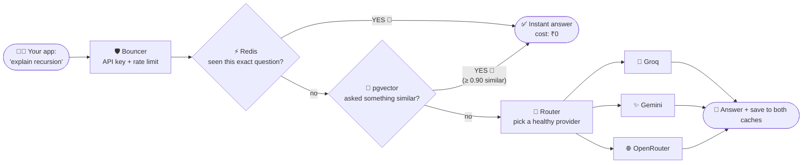

<div align="center">


<a href="https://github.com/Vicky7632">
  
</a>


-1F8ACB?style=for-the-badge&logo=codeforces&logoColor=white)


</div>

---

## 🖥️ `~/vicky/about.sh`

```bash
$ ./about.sh

 ╭──────────────────────────────────────────────────────╮
 │  👋  Hey! I'm Vicky — B.Tech CSE '26, Rungta College │
 │  📍  Bengaluru, India                                │
 │  🔭  Building : ai-proxy-router (LLM gateway)        │
 │  🌱  Learning : distributed systems, k8s, system     │
 │                 design, and how to cache everything  │
 │  ⚔️  Weapon   : C++ for contests, Python for shipping│
 │  💬  Ask me   : DSA, FastAPI, MERN, GenAI, RAG       │
 │  ⚡  Fun fact : I mentor juniors in DSA and still    │
 │                 TLE on my own submissions sometimes  │
 ╰──────────────────────────────────────────────────────╯
```

---

## 🔥 Latest Drop — [AI Proxy Router](https://github.com/Vicky7632/ai-proxy-router)

> *One endpoint. Many LLMs. Zero wasted tokens.*  
> A self-hosted gateway that sits between your app and Groq / Gemini / OpenRouter, and refuses to pay twice for the same answer. 💸

### 🎬 The life of a request (told like a thriller)



### 🧰 Superpowers

| 🦸 Power | 📖 Translation |
|---|---|
| 🧠 **Semantic cache** | "What's recursion?" and "explain recursion" → same answer, one LLM call |
| 🔐 **Paranoid by design** | API keys are shown *once*, stored as SHA-256 hashes. Even I can't read them |
| 🌊 **Streaming (SSE)** | Tokens flow live. Half-finished streams never poison the cache |
| 🚑 **Self-healing** | Provider down? Health tracking + cooldowns route around the pain |
| 📊 **Dashboard** | React 19 + Vite UI: keys, playground, provider health, cache hit-rate |
| ☸️ **Ships like a pro** | Docker Compose locally, Kubernetes manifests on Docker Desktop |

`Python 3.12` `FastAPI` `PostgreSQL + pgvector` `Redis` `React 19` `Vite` `Docker` `Kubernetes`

[📖 Architecture](https://github.com/Vicky7632/ai-proxy-router/blob/main/docs/ARCHITECTURE.md) · [📡 API Docs](https://github.com/Vicky7632/ai-proxy-router/blob/main/docs/API.md) · [⭐ Star it](https://github.com/Vicky7632/ai-proxy-router)

---

## 🗺️ `git log --oneline --graph` (my journey)

```text
* 2026  🚀  ai-proxy-router       → LLM gateway with 2-layer caching
* 2026  🧠  LectureIQ             → lectures in, summaries out
* Dec'25 💼  Veridia internship   → MERN Stack Developer
* 2025  💻  CodeGurukul           → coding platform + AI evaluation
* Sep'24 🌱  Digi Coders          → Full Stack Development Trainee
* 2022  🎓  git init              → B.Tech CSE, Rungta College
```

---

## 🧪 Other Experiments

| | Project | Vibe |
|---|---|---|
| 🧠 | [**LectureIQ**](https://github.com/Vicky7632/LectureIQ) | AI summarizes your lectures so you can pretend you paid attention (MERN · OpenAI · WebSocket) |
| 💻 | [**CodeGurukul**](https://github.com/Vicky7632/CodeGurukul-With-Ai) | LeetCode-style platform with Judge0 + AI feedback (MERN · Redis · GenAI) |
| ⚛️ | [**ReactMajorProject**](https://github.com/Vicky7632/ReactMajorProject) | Where the React muscles were built |
| 🤖 | [**FirstAiChatBot**](https://github.com/Vicky7632/FirstAiChatBot) | The origin story of my GenAI arc |

---

## 🧩 Competitive Programming Stats

<div align="center">


</div>

---

## ⚙️ `skills.config.json`

<div align="center">

<br/>


</div>

```jsonc
{
  "backend":   ["FastAPI", "Node/Express", "Django", "Flask", "SQLAlchemy", "Alembic"],
  "data":      ["PostgreSQL", "pgvector", "Redis", "MySQL"],
  "genai":     ["LangChain", "RAG", "Embeddings", "Vector DBs", "AI Agents", "Gemini", "OpenAI"],
  "infra":     ["Docker", "Kubernetes", "AWS", "CI/CD"],
  "superpower": "turning vague ideas into running containers 🐳"
}
```

---

## 📊 Stats (flex zone 💪)

<div align="center">


</div>

---

## 🤝 Let's Build Something

<div align="center">

[](https://www.linkedin.com/in/vicky-kumar-b390a1354/)
[](https://x.com/VickyKumar4545)
[](https://www.geeksforgeeks.org/profile/vicky45)
[](https://codeforces.com/profile/VickyKumar45)

```text
 Cache hit  ✅  you reached out, instant reply.
 Cache miss ❌  I'll still answer, just with extra chai ☕
```


</div>

