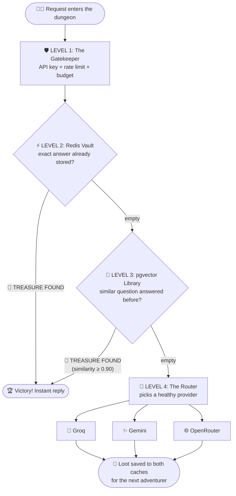

<div align="center">


<a href="https://github.com/Vicky7632">
  
</a>


</div>

---

## 🎮 CHARACTER SELECT

```text
 ╔═══════════════════════════════════════════════════════════╗
 ║  🧙  PLAYER   : Vicky Kumar                               ║
 ║  🛡️  CLASS    : Backend Artificer  (sub-class: Full-Stack) ║
 ║  🏰  GUILD    : Rungta College of Engg & Tech, Bhilai     ║
 ║  🗺️  REGION   : Bengaluru, India                           ║
 ║  ⚔️  WEAPONS  : C++ (contests)  ·  Python (shipping)       ║
 ║  🧪  MAGIC    : Redis ⚡  PostgreSQL 🐘  pgvector 🧠         ║
 ║  🐳  MOUNT    : Docker  →  upgrading to Kubernetes ☸️      ║
 ║  🎯  QUEST    : Make LLM APIs fast, cheap & reliable      ║
 ║  ☕  FUEL     : Chai (potion of +10 focus)                 ║
 ╚═══════════════════════════════════════════════════════════╝
```

### 🏅 Achievements Unlocked

| Badge | Title | How |
|:-:|---|---|
| 🦈 | **Pull Shark** | Earned on GitHub by getting pull requests merged |
| 🎲 | **YOLO** | Earned on GitHub by merging a PR without a review (very brave, very legal) |
| 🥇 | **Hackathon Finalist ×3** | Three college competitions, three finals |
| 🥈 | **Codeforces Specialist** | Max rating **1405**, 900+ problems slain |
| 🧙 | **Mentor** | Trains junior adventurers in DSA |

---

## ⚔️ MAIN QUEST: [AI Proxy Router](https://github.com/Vicky7632/ai-proxy-router)

> **Quest objective:** Build one gateway to rule all LLM providers, and stop paying twice for the same answer.  
> **Boss:** 👹 *The Token Bill*  
> **Reward:** ⚡ faster responses, 💸 lower cost, 😌 peaceful sleep

### 🗺️ The Dungeon Map (every request must survive it)



### 🎒 Inventory (what this repo carries)

| Item | Effect |
|---|---|
| 🧠 **Semantic Cache Amulet** | "What is recursion?" ≈ "explain recursion" → one LLM call, not two |
| 🔐 **Cloak of SHA-256** | API keys are shown once, stored only as hashes. Not even the dev can read them |
| 🌊 **Streaming Boots** | Live SSE tokens. Broken streams are never cached |
| 🚑 **Healing Potion** | Provider health tracking + cooldown when a provider goes down |
| 📊 **Scrying Mirror** | React dashboard: keys, playground, provider health, cache hit-rate |
| ☸️ **Dragon Mount** | Runs on Docker Compose and local Kubernetes |

`Python 3.12` `FastAPI` `PostgreSQL + pgvector` `Redis` `React 19` `Vite` `Docker` `Kubernetes`

[📜 Architecture Scroll](https://github.com/Vicky7632/ai-proxy-router/blob/main/docs/ARCHITECTURE.md) · [📡 API Spellbook](https://github.com/Vicky7632/ai-proxy-router/blob/main/docs/API.md) · [⭐ Give it a star](https://github.com/Vicky7632/ai-proxy-router)

---

## 🧭 SIDE QUESTS

| 🏷️ | Quest | Loot |
|:-:|---|---|
| 🧠 | [**LectureIQ**](https://github.com/Vicky7632/LectureIQ) | Turns long lectures into summaries *(MERN · OpenAI · WebSocket)* |
| 💻 | [**CodeGurukul**](https://github.com/Vicky7632/CodeGurukul-With-Ai) | Coding arena with Judge0 + AI feedback *(MERN · Redis · GenAI)* |
| ⚛️ | [**ReactMajorProject**](https://github.com/Vicky7632/ReactMajorProject) | The training grounds for React skills |
| 🤖 | [**FirstAiChatBot**](https://github.com/Vicky7632/FirstAiChatBot) | The tutorial level of my GenAI arc |

---

## 📜 QUEST LOG (the story so far)


---

## 👹 BOSS FIGHTS (Competitive Programming)

<div align="center">


</div>

---

## 🧰 SKILL TREE

<div align="center">

<br/>


</div>

```text
🌳 SKILL TREE
 ├── ⚔️  Combat        → C++, DSA, problem solving
 ├── 🧙 Backend Magic  → FastAPI · Node/Express · Django · Flask · SQLAlchemy
 ├── 🧠 Dark Arts (AI) → LangChain · RAG · Embeddings · Vector DBs · AI Agents
 ├── 🏰 Fortress       → PostgreSQL · pgvector · Redis · MySQL
 ├── 🐳 Logistics      → Docker · Kubernetes · AWS · CI/CD
 └── 🎨 Illusion       → React · Redux · Tailwind · Vite · TypeScript
```

---

## 📈 PLAYER STATS

<div align="center">


</div>

---

## 🐍 CONTRIBUTION SNAKE

<div align="center">
  <picture>
    <source media="(prefers-color-scheme: dark)" srcset="https://raw.githubusercontent.com/Vicky7632/Vicky7632/output/github-snake-dark.svg" />
    
  </picture>
</div>

---

## 💾 SAVE POINT & CONTACT

<div align="center">

[](https://www.linkedin.com/in/vicky-kumar-b390a1354/)
[](https://x.com/VickyKumar4545)
[](https://www.geeksforgeeks.org/profile/vicky45)
[](https://codeforces.com/profile/VickyKumar45)

```text
 ┌──────────────────────────────────────────┐
 │   🎮  GAME PAUSED                         │
 │                                          │
 │   [A] Hire me        [B] Collab on code  │
 │   [X] Talk DSA       [Y] Share chai ☕    │
 └──────────────────────────────────────────┘
```


</div>
